# SiQL (Simple Query Language)


### *A Python API for local tables and data access/searching much like [SQLite](https://sqlite.org/)*
This Python library is intended to make data access and usage simpler with single calls and query chains

## Installation
Requires CPython 3.11+. No third-party runtime dependencies. All implementation modules compile to C++
extensions using Cython; searching also uses the C engine. Wheels contain native extensions for their Python
version and platform. Building from source requires a C/C++ compiler (MSVC on Windows, GCC or Clang on Linux/macOS).
```
pip install SiQL
```

For a local native build and the existing test suite:
```
python -m pip install -e .
python -m unittest discover -s src/siql/tests -t src -v
python -m build
```

`python tools/check_native.py` verifies every implementation loaded as an extension.
`python tools/test_wheel.py dist/<wheel-filename>.whl` installs a wheel into a temporary directory and runs
the same tests against that installed distribution.

The maintained Python syntax is the input to Cython's C++ compiler, rather than a handwritten standalone C++
API. Generated C++ is under `build/cython/`; installed wheels keep only package exports and `python -m` launchers
as Python files, including a binding shim for `Table.find` to preserve `unittest.mock` autospec behavior.
Each implementation module loads directly from a `.pyd` (Windows) or `.so` (Linux/macOS).
The Python API and table file format remain the same. `SIQL_PURE_PYTHON=1` selects the reference search
algorithms for comparison; those algorithms also run as compiled C++ in the native distribution.

SiQL has three layers. Use only the ones you need: `import siql` loads just the library, the
interpreter loads the first time it's used, and the server only when you import `siql.server`.

## .NET library

The standalone C# port targets .NET 8 or later and needs no Python runtime. Build with
`dotnet build dotnet/SiQL/SiQL.csproj -c Release`; create the local NuGet package with
`dotnet pack dotnet/SiQL/SiQL.csproj -c Release -p:PackageOutputPath=../../dist/dotnet`.

It includes the table and diff APIs, existing file format, search modes, rolling cache,
SQL interpreter, CSV, HTTP server, and command-line tools. Shared fixtures compare Python
and C# behavior and bidirectional files. See the [.NET usage guide](dotnet/README.md) and
[feature/parity map](dotnet/PARITY.md). The CRUD review below includes separately
measured C# results; the older benchmark sections measure Python/C++.

## CRUD performance review

The 2026-10-16 review retains row-position maps across eager deletes in both runtimes,
avoids Python's redundant parsing of ordinary commit values, and reduces C# comparison
and lookup allocations. Features, defaults, immediate saving, and exact results are preserved.

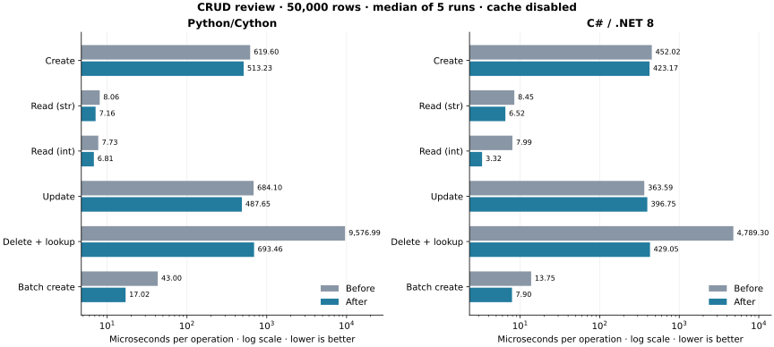

<!-- CRUD_REVIEW_START -->

| Runtime | Operation | Before (µs/op) | After (µs/op) | Before / after |
|---|---|---:|---:|---:|
| Native Python | Create | 619.60 | 513.23 | 1.21× |
| Native Python | Read (str) | 8.06 | 7.16 | 1.13× |
| Native Python | Read (int) | 7.73 | 6.81 | 1.14× |
| Native Python | Update | 684.10 | 487.65 | 1.40× |
| Native Python | Delete + lookup | 9,576.99 | 693.46 | 13.81× |
| Native Python | Batch create | 43.00 | 17.02 | 2.53× |
| C# / .NET 8 | Create | 452.02 | 423.17 | 1.07× |
| C# / .NET 8 | Read (str) | 8.45 | 6.52 | 1.30× |
| C# / .NET 8 | Read (int) | 7.99 | 3.32 | 2.41× |
| C# / .NET 8 | Update | 363.59 | 396.75 | 0.92× |
| C# / .NET 8 | Delete + lookup | 4,789.30 | 429.05 | 11.16× |
| C# / .NET 8 | Batch create | 13.75 | 7.90 | 1.74× |

<!-- CRUD_REVIEW_END -->

Five runs per runtime/version on Windows, 50,000 rows, 500 probes, caching disabled.
Reads use an already-built position map; individual writes save each operation;
bulk insertion saves one change. These are sequential development-machine measurements,
so small differences can reflect noise. C# single-row updates were about 9% slower in this run;
the changes do not improve every operation. The [methods review and raw samples](docs/CRUD_PERFORMANCE.md)
explain the changes, remaining costs, validation, and reproduction commands.
The benchmark sections farther below retain their dated 2026-10-14 measurements,
which predate these changes.

## Command line
```
python -m siql "CREATE TABLE people (name str, age int)"
python -m siql "INSERT INTO people VALUES ('Ann', 31), ('Bob', 25)"
python -m siql "SELECT * FROM people WHERE age > 30"
python -m siql -d data "SHOW FILES"          # -d: folder of table files (default: current folder)
python -m siql -f setup.sql                  # run a script file
python -m siql                               # interactive shell (also installed as `siql`)
```
Separate several statements with `;`. Exit code is 1 if a statement fails.

## 1. Python library
```python
from siql import Table, Database

db = Database("data")                       # folder of .siql table files
people = db.create("people", name=str, age=int)
people.add(name="Ann", age=31)
db.rename("people", "staff")
db.copy("staff", "backup")
db.table("staff").compact()                 # rewrite the file without its change history
print(db.table("staff"))
```

### Search tree
Every `Table` keeps a search tree by default (`Table(tree=True)`), in layers: column name, then the first
character of a string or first digit of a number, then the table's own `Row` and `Cell` objects.
Inside each string or number branch, values are also kept in a skip list: each new value gets a random height and
joins that many "express lanes", placed by comparing it with the values already there. A lookup runs along the
sparsest lane and drops down, jumping over most of the branch, so it takes about log(n) comparisons instead of
checking every value. Values that can't be ordered (`None`, lists, `nan`, ...) sit in their own branch and are checked
one by one.
`find`, `select`, `editByName` and the interpreter's `WHERE col = value` use it instead of scanning every row.
It's kept current on every change, including direct `cell.value = ...` assignments, and rebuilt when a table loads.
```python
people.index["name"]["A"]                   # rows whose name starts with "A"
people.find("name", "Ann")                  # indices of matching rows
people.tree = False                         # discard the tree (set True to rebuild it)
```

#### Lazy additions (optional)
`Table(lazy_add=True)` defers inserting new cells into the search tree's skip-list lanes. Rows,
column lists, and the saved change log update immediately. Searches see new rows immediately:
they first index pending additions in the branches they need, just as lazy delete cleans those
branches before reading them. Unrelated branches and columns remain pending.

```python
people.lazy_add = True                     # also available in the Table constructor
people.add(name="Dee", age=28)             # saved now; tree insertion can wait
people.find("name", "Dee")                 # indexes the needed name branch, then searches
print(len(people.index["age"].pending))     # cells still waiting in this column
people.purge()                             # finish both lazy additions and lazy deletions
people.lazy_add = False                    # finish pending additions and resume eager inserts
```

The option defaults to off and can be combined with `lazy_delete=True`. Pending cells still
notify the index on direct edits; deleting an unindexed row cancels its pending insertion.
Cached matches and misses are invalidated on insertion. Batch searches keep their normal chained
traversal after indexing the needed branches. SQL scans already read the updated column lists.
Compressed multi-column searches keep their prefix membership current independently.

To bound the queue, a column indexes all its pending additions when their count exceeds the larger
of 64 and its currently indexed live-cell count. `purge()` and disabling lazy add finish remaining
work explicitly. Reload and schema/tree rebuilds build ordinary complete indexes. This shifts
indexing cost from insertion to later searches or flushing; it does not defer saving or guarantee
lower total work.

A 5,000-row bulk append into a 50,000-row table measured:

| Phase | Eager add (ms) | Lazy add (ms) |
|---|---:|---:|
| Append | 190.02 | 187.13 |
| First read | 5.68 | 14.70 |
| Flush | 0.51 | 4.45 |
| Total | 195.82 | 206.06 |

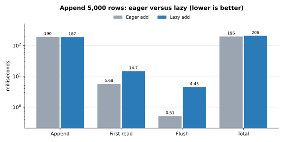

Measured on 2026-10-14 on Windows, Python 3.12.8,
7 repeats, with caching disabled and a fresh table each repeat. Append includes
serialization and saving; the first read includes building the position map. Total includes append,
first read, and flushing the remaining index work. The phases show where costs move rather than
claiming a general speed-up. [Raw results](docs/benchmarks/lazy_add_results.json) include each run.
Reproduce with `python benchmarks/lazy_add.py`; use `--replot` to redraw the graph.

#### Compressed column search (optional)
`Table(compressed_search=True)` builds a hidden signature from every column: the first Unicode
character of text, the first decimal digit of a number (ignoring its sign), or the first byte of
binary values. Each prefix has an interned, typed symbol; a signature packs four bytes per column
and is shared by rows with identical signatures. It groups rows before running the existing exact
column trees within each matching group.

```python
people.compressed_search = True
people.find("name", "Ann")                  # ordinary column tree and rolling cache
people.find_where(name="Ann", age=31)       # intersect prefixes, then exact AND equality
print(people.compressed_info)               # groups, signature bytes, candidate rows and trees
people.compressed_search = False            # release the extra index
```

Single-column searches use the ordinary tree even with `compressed_search=True`. This includes
`find`, single-criterion `find_where`, and SQL equality lookups. `find_batch` retains its chained
tree traversal and rolling cache. Grouping applies when a search constrains at least two columns.
Partial multi-column queries visit every compatible full-signature group. Prefix collisions cannot produce
final matches without exact equality. Empty values and NULL have distinct symbols; unsupported
values use wildcard groups to preserve custom equality. Numeric equality such as `1 == 1.0`
uses the same prefix. Direct edits, insertions, deletions, rollback, and schema changes refresh
group membership before the next grouped search. In-place binary edits are also checked. Signatures
are in memory only, outside the visible schema and saved file, and rebuilt on reload.

With this option enabled, SQL `AND` expressions containing only equality comparisons on distinct
columns also use the grouped path. Other predicates retain their existing evaluation.
`tree=False` suspends the extra index.

This mode defaults to off. At 100,000 rows on native Windows (lower is better):

| Exact predicates | Tree + narrowed scan (µs/query) | Groups, first pass | Groups, warm trees |
|---|---:|---:|---:|
| One column | 157.92 | 1,353.40 | 632.86 |
| Two columns | 283.06 | 1,042.56 | 131.59 |
| All three columns | 284.12 | 108.37 | 48.28 |

The single-column grouped numbers deliberately force the prototype path; public single-column
searches use the ordinary tree. Warm all-column searches took
48.28 µs versus
284.12 µs for the ordinary tree, with about
28 candidate rows. Single-column grouping visited
about 159 groups per query.

Group trees are built lazily; first-pass timings include that cost. Workloads run sequentially,
so later first passes may reuse trees from earlier workloads. Initial group formation is reported
separately. Index storage lies outside the rolling cache budget; cached group results share it.

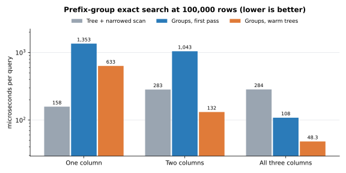

Measured on 2026-10-14 with Python 3.12.8 on Windows,
300 queries per workload, 9 repeats, and result caching disabled.
Every query agreed with ordinary search. The fixture has 512 names, ages 0–99, and two-byte values.
[Raw measurements](docs/benchmarks/compressed_search_results.json) include all sizes and repeats.
Reproduce with `python benchmarks/compressed_search.py`; `--replot` redraws the graph.

#### Full-row integer search (optional)
`Table(integer_search=True)` encodes the full supported value of every column into bytes, pads
each column to its observed maximum encoded width, and packs those bits into one integer.
The index sorts these integers in schema column order; public results retain their ordinary row
order. This is an additional index, and it defaults to off. Single-column searches keep using
the ordinary tree and cache.

```python
people.integer_search = True
people.find_where(name="Ann", age=31)
print(people.integer_info)                 # bit width, seek, range size, backtracking
people.integer_search = False
```

For unsearched fields, the initial jump uses the row-weighted mean encoded value minus one
quarter of its observed range, clamped to safe bounds. This deliberately aims below the mean.
It estimates encoded bits, rather than a semantic average of names or other text. An estimate
can still land after a match, so searches scan forward and back within a conservative integer
interval, test the specified field bits, and finally check exact values. No valid match is
discarded because it falls before the estimated jump. A lower-bound seek is also measured by
the benchmark to isolate whether the estimate helps.

Strings retain their full UTF-8 encoding (including trailing NULs), binary fields retain every
byte, and numeric values use a canonical numerator/denominator encoding so `1`, `1.0`, and `True`
share bits. Length prefixes distinguish padding from actual data. This order is an order of
encoded bits, rather than numeric, lexical, or semantic similarity. Custom and unsupported
values use wildcard routing followed by exact comparisons.

Edits and schema changes invalidate the sorted order; the next grouped search rebuilds it,
including wider column slots when needed. Mutable binary values are checked before searching.
The encoded values, sorted keys, and auxiliary maps consume memory outside the rolling cache
budget. The index is in memory only and is rebuilt on reload. SQL equality conjunctions use
this path when enabled. Integer mode takes precedence if compressed prefix mode is also enabled;
disabling integer mode restores the prefix mode.

The first columns dominate the packed integer. Queries omitting an early column can span most
of the sorted index, and jumping near an average does not reduce the work needed to return all
exact matches in that interval.

At 100,000 rows on native Windows, warm exact searches measured:

| Searched columns | Ordinary tree (µs/query) | Prefix groups | Integer, low estimate | Integer, lower bound |
|---|---:|---:|---:|---:|
| Leading pair | 282.73 | 129.18 | 11.71 | 9.05 |
| Hole in middle | 289.36 | 107.39 | 24.94 | 25.94 |
| Nonleading pair | 1,509.78 | 319.52 | 5,322.07 | 5,071.58 |
| All columns | 282.48 | 45.35 | 8.78 | 7.59 |

The leading pair scanned about 3 integer keys;
the pair omitting the first column scanned about
99,099. The two seeks cover identical ranges:
estimating the initial jump does not remove the need to check earlier matches. Individual timings
vary, so small differences are not evidence of a general advantage for either jump strategy.
Integer index formation and sorting took 0.77 seconds,
excluded from query timing. Mutations and wider fields can make rebuilding costly.

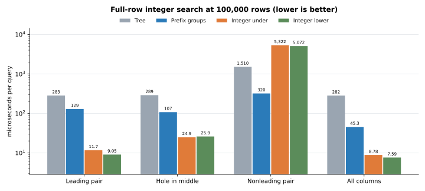

Measured on 2026-10-14, Python 3.12.8 on Windows,
100 queries per workload, 5 repeats, with caching disabled.
Every result agreed with ordinary search. Modes run sequentially; lower-bound trials reuse the
integer index. Both integer trials use identical direct calls and position conversion.
[Raw results](docs/benchmarks/integer_search_results.json) include smaller sizes and each run.
Reproduce with `python benchmarks/integer_search.py`; `--replot` redraws the graph.

#### Rolling query-result cache
Each table has a least-recently-used cache for indexed exact lookups, with a default budget of
100 MB (100,000,000 bytes). It fills on demand; the limit is not preallocated. `find`, `find_batch`,
`select`, and indexed SQL equality/`IN` lookups share it. The oldest unused results are evicted as
new results fill the byte budget, and every hit refreshes its recency.

```python
people = Table(file="people.siql", cache_max_bytes=100_000_000)
people.find("name", "Ann")                 # tree lookup, then retained in the cache
people.find("name", "Ann")                 # cached rows, resolved through the current position map
people.cache_max_bytes = 25_000_000         # resize at runtime; shrink evicts immediately
print(people.cache_info)                    # bytes, entries, hits, misses, evictions, invalidations
people.clear_cache()                       # release results while keeping the tree
people.cache_max_bytes = 0                  # disable caching
```

Entries retain references to the table's live rows. They do not duplicate row values or retain old
row positions; results keep the same ordering and return fresh lists. Edits invalidate results for
the affected column, including direct cell assignments. Inserts, deletes, column removal, and
rollback also keep the cache coherent. Changing an unrelated column preserves the useful cached
rows, and subsequent reads see that column's current values. Cached misses are invalidated too.

The budget conservatively accounts for query keys, row-reference tuples, and per-entry bookkeeping.
It limits retained cache storage, rather than total process memory or the table's existing rows.
Oversized entries are skipped without evicting useful smaller results. Shrinking also compacts the
backing maps to release their old capacity. Cache state is in memory only and is empty after reload.

Only immutable builtin query values with stable equality are cached. Columns containing mutable
values, custom objects/subclasses, or NaN bypass caching so in-place edits and custom equality remain
correct. `tree=False`, range predicates, and other scan-based SQL predicates use the ordinary search
path. Set a table's `cache_max_bytes` after opening it through `Database` to change its budget.

#### Caching values encountered during traversal
`Table(cache_traversed_nodes=True)` also admits the exact-value results of every unique node
inspected during an indexed search, including successors that stop a lane's scan. Later queries for
those values can hit the existing cache even when they were not previous query destinations.
The native and reference skip lists support this for individual and batch lookups.

```python
people.cache_traversed_nodes = True
people.find("name", "Ann")
print(people.cache_info["traversal_nodes_seen"])
print(people.cache_info["traversal_admissions"])
```

The nodes are already resident in the tree; this mode adds shortcuts to their exact-value results.
It keeps live row references and uses the same rolling byte budget and mutation invalidation as
ordinary cached results. Inspected values and requested results compete in one LRU; requested values
are touched last. Express-lane jumps retain their normal behavior. The cache records compared nodes
without expanding the ranges they skip, and it retains no raw native node pointers.

This mode is off by default. At 100,000 rows on native Windows, starting with an empty cache:

| Workload | Results only (µs/query) | Inspected nodes (µs/query) | Inspected-node hit rate |
|---|---:|---:|---:|
| Random distinct | 9.07 | 39.69 | 5.1% |
| Nearby distinct | 4.25 | 12.42 | 21.2% |
| Repeated names | 0.89 | 2.09 | 96.8% |

Random distinct searches retained 7.15 MB and
10,652 entries with traversal admissions, versus
0.67 MB and 1,000 entries for results only.
The separate mutation stress passed 30,000 SQLite comparisons
with zero mismatches. `cache_traversed_nodes=False` stops new traversal admissions;
`clear_cache()` removes already admitted entries when comparing modes.

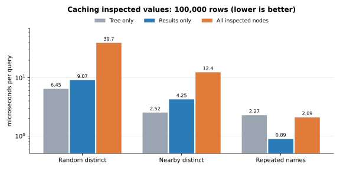

Measured on 2026-10-14, Python 3.12.8 on Windows,
9 repeats using the same live tree. Queries include admission and conversion;
repeated-name timing includes the initial cache fill.
[Raw results](docs/benchmarks/traversal_cache_results.json) include all runs and stress results.
Reproduce with `python benchmarks/traversal_cache.py`; `--replot` redraws the graph.

#### Cache speed and stress against SQLite
The cache and tree were compared with indexed SQLite on 1,000, 10,000, 50,000, and 100,000 rows,
up to 3,000 queries per workload and 9 repeats. Timings include
returning all row IDs. Repeated names use 32 names; fan-out uses 16 categories. Distinct-key traces
start with an empty result cache. SQLite statements and pages are warm; plans use covering indexes.
Fixtures and prewarming are excluded.

Native Windows results at 100,000 rows (µs/query; lower is better):

| Workload | SiQL tree, cache off | SiQL cache | SQLite in memory | SQLite file, warm |
|---|---:|---:|---:|---:|
| Repeated names | 2.44 | 0.76 | 1.51 | 26.61 |
| Cold distinct names | 7.44 | 9.60 | 1.92 | 26.63 |
| Repeated fan-out | 177.39 | 71.85 | 131.14 | 159.28 |

The file-backed case includes normal file and locking work, with warm pages. It does not measure
cold-disk reads or durable writes. SiQL keeps rows resident; these compare indexed lookups rather
than general SQL performance or total database memory.

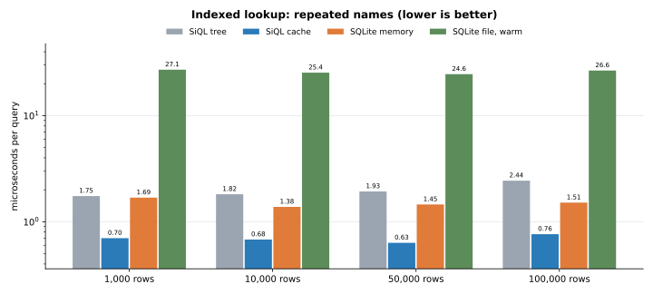
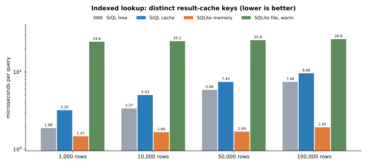
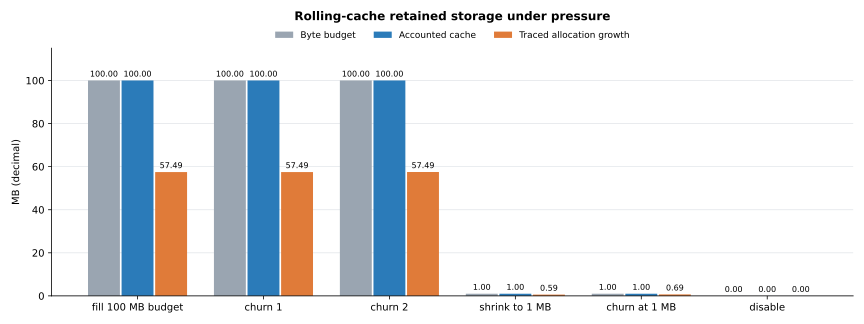

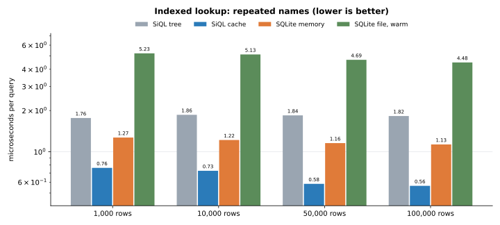
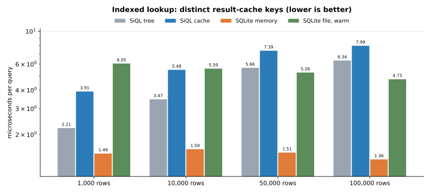
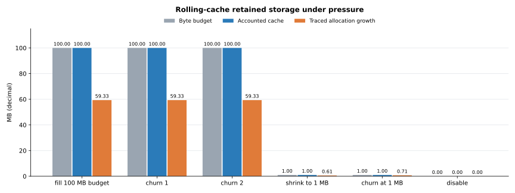

Stress passed on both Windows and WSL: 10,000 mixed operations per platform,
30,000 SQLite comparisons each, zero mismatches, and matching compacted reloads.
The trace includes edits, appends, lazy deletes, runtime resizes, and column renames. Each platform
also ran 520,000 cache-pressure queries. Windows filled to
100.00 MB of accounted cache with
57.49 MB of traced growth. Shrinking to 1 MB left
0.59 MB traced; disabling removed all entries.
Traced allocation growth excludes existing rows and is not process RSS. Tracing affects stress timing.

Measured on 2026-10-14 (Windows) and 2026-10-14 (WSL2),
Intel Core Ultra 7 165U. Windows: Python 3.12.8 / SQLite 3.45.3;
WSL: Python 3.14.4 / SQLite 3.46.1. WSL repeated-name results were
0.56 µs for SiQL cache, 1.13 µs for SQLite in memory, and
4.48 µs for warm file SQLite.
Raw [Windows lookups](docs/benchmarks/windows_cache_tests/cache_sqlite_results.json),
[Windows stress](docs/benchmarks/windows_cache_tests/cache_stress_results.json),
[WSL lookups](docs/benchmarks/cache_sqlite_results.json), and
[WSL stress](docs/benchmarks/cache_stress_results.json) include runs and snapshots.
The separate CRUD and batch comparisons below use caching disabled.
Reproduce with `python benchmarks/cache_sqlite.py`; `--no-plots` supports environments without
Matplotlib, `--output DIRECTORY` separates platform results, and `--replot` redraws the graphs.

#### Chained batch tree searches
`find_batch` searches exact values through the existing tree. It groups queries by branch, orders nearby
tree keys together, and keeps a temporary skip-list search finger for that batch. Nearby forward queries
ascend enough lanes to span the next target, then descend from saved predecessors; wider jumps switch
directly to the saved express lanes. A backward
query starts a fresh search. The finger is discarded when the batch ends, so subsequent edits cannot
leave a stale cursor. Matches always use exact key equality.

```python
queries = ["Ann", "Bob", "Anne", "Ann"]
matches = people.find_batch("name", queries)
assert matches == [people.find("name", value) for value in queries]

# Compare ordering strategies and independent traversal within the batch:
unsorted = people.find_batch("name", queries, order="input")
fresh = people.find_batch("name", queries, chained=False)
```

The returned list stays in input order, including duplicate queries and empty lists for misses.
`order="tree"` is the default: lexical order for strings and numeric order for numbers, within each
branch. `order="input"` groups by branch without sorting its queries. Unordered/custom values use
the existing exact fallback, lazy deletes are purged before traversal, and `tree=False` uses
independent scans.

Tree ordering adapts traversal to batch density: it reuses a finger when a branch receives at least
eight queries and the query count is at least 1/64 of its cell count; shorter or sparser groups use
fresh seeks. This heuristic avoids spending more on cursor maintenance than the search saves.
`chained=False` always uses fresh paths. Input ordering reuses a finger on forward seeks.

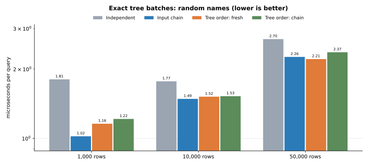
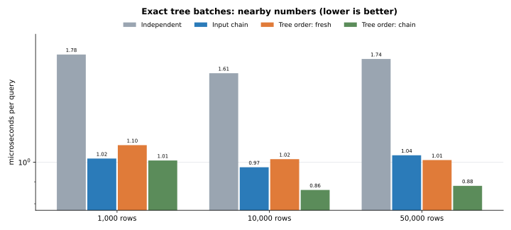
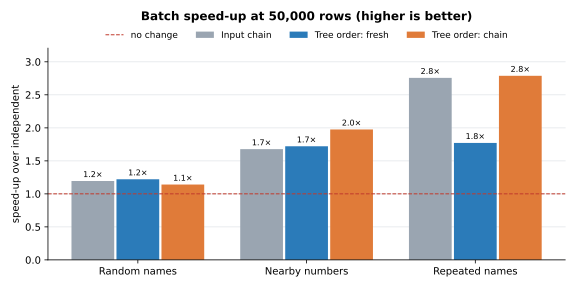

At 50,000 rows with 300-query batches:

| Workload | Independent (µs/query) | Tree order + chain (µs/query) | Speed-up |
|---|---:|---:|---:|
| Random names | 2.70 | 2.37 | 1.14× |
| Nearby numbers | 1.74 | 0.88 | 1.98× |
| Repeated names | 1.55 | 0.55 | 2.79× |

All batch modes matched independent exact searches. Batching saves calls and repeated branch work;
the fresh-path comparison isolates additional traversal effects.
Measured on 2026-10-14, native Python 3.14.4 on WSL2,
9 repeats with 20 warm batches per pass, caching disabled.
Nearby queries are shuffled contiguous numbers within one branch; repeats sample eight names.
Timing includes ordering and restoring input order. [Raw results](docs/benchmarks/batch_results.json)
include batch sizes 8, 32, 128, and 512. Reproduce with `python benchmarks/batch.py`;
`--replot` redraws the graphs.

#### Lazy delete
`Table(lazy_delete=True)` (off by default) queues the tree's cleanup for deleted rows instead of doing it at once.
The row still leaves `rows`, `cols` and the file immediately, so nothing else sees it. In the tree, each of its
cells is queued under the branch it sits in; a search unlinks the queued cells of just the branches it reads, before
reading them, so a lookup never sees a deleted row and never checks branches it doesn't need. Both eager and lazy
deletes now retain bounded position offsets instead of rebuilding the position map after every delete. The tree queue empties
itself if it grows past the size of the table, and `table.purge()` empties it on demand. It can also be switched
at any time with `table.lazy_delete = True`.

Without the tree (`tree=False`), `lazy_delete` has no effect: there's no tree cleanup to put off, so deletes work
exactly as normal. Turning the tree on later builds it from the current rows, and lazy deletes apply from then on.

Only the tree's cleanup waits; the delete itself never does. Each delete is written to the table file when it's
made, as the same line it would be without lazy delete, and the queue exists only in memory. So nothing has to run
at shutdown: a process can exit, or be killed, with deletes still waiting, and the next load replays the file
without those rows and builds the tree without them.

#### Performance: tree off vs on vs lazy delete, and SQLite
These dated measurements predate the [2026-10-16 CRUD improvements](#crud-performance-review).

Each operation was timed on tables of 1,000, 10,000 and 50,000 rows (`name` = random 8-letter string,
`n` = row number), with 300 operations of each kind, taking the median of 3 runs. SiQL ran with all
implementation modules compiled to C++ and the C search engine enabled, with result caching disabled.
Lazy add and both optional composite indexes were off. SQLite (3.46.1, through
Python's `sqlite3`) ran the same steps with every statement saved on its own (autocommit) and
`synchronous=OFF`. "SQLite, indexed" also has an index on each column.

| Operation | What's timed in SiQL | What's timed in SQLite |
|---|---|---|
| Create | `table.add(...)`, one row at a time, each saved to the file | `INSERT`, one row per statement |
| Read (str) / Read (int) | `table.find("name", value)` / `table.find("n", value)` | `SELECT rowid ... WHERE name = ?` / `n = ?` |
| Update | `table.editByName("name", old, new)` | `UPDATE ... SET name = ? WHERE name = ?` |
| Delete | `table.find(...)` then `DropRow` for the match | `DELETE ... WHERE name = ?` |

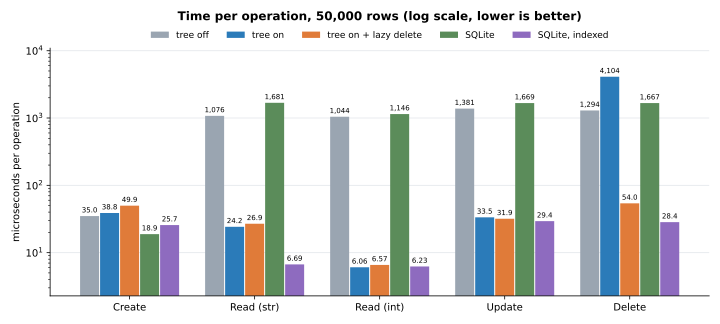
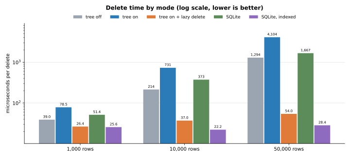
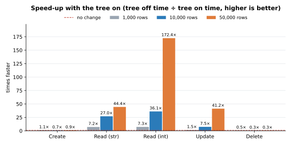
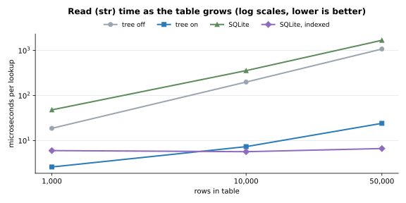

| Operation | Rows | Tree off (µs/op) | Tree on (µs/op) | Tree on + lazy delete (µs/op) | SQLite (µs/op) | SQLite, indexed (µs/op) |
|---|---:|---:|---:|---:|---:|---:|
| Create | 1,000 | 32.1 | 29.2 | 30.3 | 19.4 | 26.2 |
| Create | 10,000 | 27.3 | 36.9 | 39.3 | 18.5 | 23.6 |
| Create | 50,000 | 35.0 | 38.8 | 49.9 | 18.9 | 25.7 |
| Read (str) | 1,000 | 18.8 | 2.6 | 2.1 | 48.2 | 6.0 |
| Read (str) | 10,000 | 199.4 | 7.4 | 6.8 | 357.4 | 5.7 |
| Read (str) | 50,000 | 1,076.3 | 24.2 | 26.9 | 1,681.3 | 6.7 |
| Read (int) | 1,000 | 15.6 | 2.1 | 1.9 | 30.9 | 5.5 |
| Read (int) | 10,000 | 161.6 | 4.5 | 4.0 | 230.5 | 5.1 |
| Read (int) | 50,000 | 1,044.1 | 6.1 | 6.6 | 1,145.9 | 6.2 |
| Update | 1,000 | 39.9 | 26.9 | 22.4 | 59.4 | 27.2 |
| Update | 10,000 | 247.3 | 33.1 | 28.5 | 368.9 | 23.8 |
| Update | 50,000 | 1,380.8 | 33.5 | 31.9 | 1,669.1 | 29.4 |
| Delete | 1,000 | 39.0 | 78.5 | 26.4 | 51.4 | 25.6 |
| Delete | 10,000 | 214.2 | 730.9 | 37.0 | 373.5 | 22.2 |
| Delete | 50,000 | 1,293.9 | 4,104.3 | 54.0 | 1,666.7 | 28.4 |

These measurements show:

- Reads and updates are 1.5–172× faster with the tree than without across the tested sizes.
- At 50,000 rows, tree-on integer lookups take 6.1 µs versus
  6.2 µs for indexed SQLite; updates take
  33.5 versus 29.4 µs.
- String lookups include building the row-position map on their first lookup. Integer lookups run next and
  reuse it. These are workload averages, not measurements of warmed-up lookups alone.
- At 50,000 rows, lazy deletes take 54.0 µs versus
  4,104.3 µs with the plain tree, a 76.0×
  improvement in that snapshot. The plain tree rebuilt its position map after each deletion then;
  the current implementation retains bounded offsets for eager deletes too.

#### Native C++ compared with the same Python source
The current maintained source was run as interpreted Python and as compiled C++ on the same
machine, using the same Python version, data, C search engine, and benchmark settings. The runs were
sequential. The Python run uses an isolated source copy with the identical native C search extension.
Speed-up is Python time divided by native time: above 1× is faster; below 1× is slower.

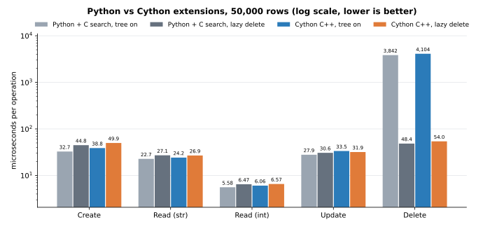
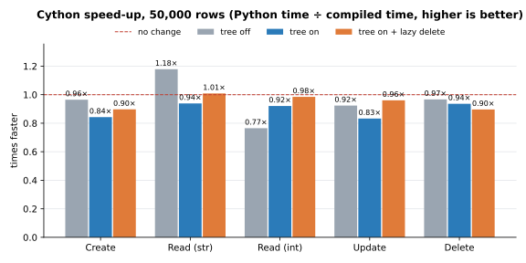

| Operation | Python source, tree on (µs/op) | Native C++, tree on (µs/op) | Tree-on speed-up | Lazy-delete speed-up |
|---|---:|---:|---:|---:|
| Create | 32.7 | 38.8 | 0.84× | 0.90× |
| Read (str) | 22.7 | 24.2 | 0.94× | 1.01× |
| Read (int) | 5.6 | 6.1 | 0.92× | 0.98× |
| Update | 27.9 | 33.5 | 0.83× | 0.96× |
| Delete | 3,842.1 | 4,104.3 | 0.94× | 0.90× |

Tree-on speed-ups at 50,000 rows range from 0.83× to 0.94× across these operations.
All five tree-on operations were slower in this run. File writes, Python object comparisons, and
table-file parsing still contribute to the timings. Sequential runs and timing noise can affect
comparisons. These results describe this workload and machine.

#### Storage
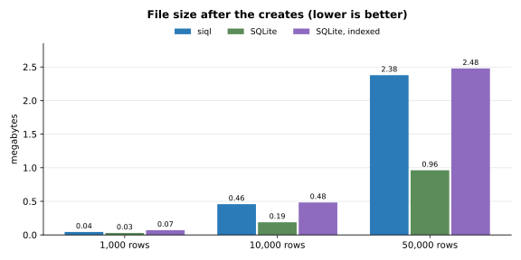

| Rows | siql (MB) | SQLite (MB) | SQLite, indexed (MB) |
|---|---:|---:|---:|
| 1,000 | 0.04 | 0.03 | 0.07 |
| 10,000 | 0.46 | 0.19 | 0.48 |
| 50,000 | 2.38 | 0.96 | 2.48 |

At 50,000 rows, SiQL's file is 2.5× the size of unindexed SQLite's. Its readable text repeats
column names on every row; SQLite stores rows in binary. SiQL's search tree lives in memory and is rebuilt
when a table loads, while SQLite keeps its indexes in the file. SiQL keeps the whole table in memory;
SQLite reads from disk as needed. Memory use was not measured.

#### Reads and writes while deletes are waiting
The same 50,000-row table, but each operation is timed right after 1,000 random rows were deleted (untimed),
so with lazy delete those deletes are still waiting in the tree. "Read (str), again" repeats the previous
lookups, and "Delete + read" alternates deleting a random row with looking one up. Each phase starts with
a fresh batch of deletes, apart from the repeated lookups.

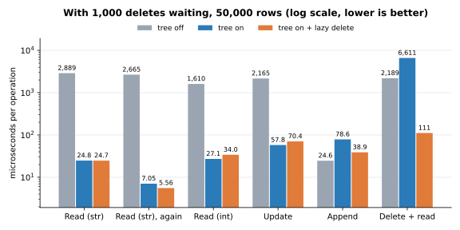

| Operation | Tree off (µs/op) | Tree on (µs/op) | Tree on + lazy delete (µs/op) | Lazy vs tree on |
|---|---:|---:|---:|---:|
| Read (str) | 2,889.1 | 24.8 | 24.7 | 1.00× |
| Read (str), again | 2,664.7 | 7.1 | 5.6 | 1.27× |
| Read (int) | 1,609.6 | 27.1 | 34.0 | 0.80× |
| Update | 2,165.3 | 57.8 | 70.4 | 0.82× |
| Append | 24.6 | 78.6 | 38.9 | 2.02× |
| Delete + read | 2,189.1 | 6,610.6 | 111.2 | 59.45× |

The first lookups after lazy deletes clean the branches they read. Repeated string lookups take
5.6 µs with lazy delete and 7.1 µs
with the plain tree. Mixed deleting and reading takes 111.2 µs with lazy
delete, 6,610.6 µs with the plain tree, and
2,189.1 µs without a tree. Lazy delete is
59.4× faster than the plain tree for that workload.

Measured on 2026-10-14 with SiQL 1.0.0 (native C++ modules and C search), SQLite 3.46.1,
Python 3.14.4, Linux (WSL2), Intel Core Ultra 7 165U. Raw native numbers are in
[results.json](docs/benchmarks/results.json); the same-machine Python baseline is in
[results-python.json](docs/benchmarks/results-python.json). Run `python benchmarks/crud.py` for the full
benchmark (`--quick` for a short run, `--replot` to redraw saved results).
Run `python benchmarks/compare_native.py` to redraw the native comparison graphs from both result files.

#### C search functions
The skip lists, whole-column scans (`=`, `!=`, `<`, `<=`, `>`, `>=`, `IS [NOT] NULL`, `LIKE`) and value
extraction for `ORDER BY` use the C engine in `siql._speedups`. The complete distribution also compiles
the table, persistence, parser, interpreter, and server modules to C++ using Cython.
`siql.helpers.search.SPEEDUPS` reports whether the C search engine is active. `SIQL_PURE_PYTHON=1`
selects the reference search algorithms, which are also compiled in the native distribution. The existing
tests verify both search implementations give the same answers.

The interpreter combines `WHERE` scans and tree lookups as sets of row numbers. `ORDER BY` sorts row
numbers and builds only the returned rows. Query-specific timings were not rerun for this CRUD comparison;
the tables above report the operations listed in the benchmark methodology.

## 2. Query interpreter (optional)
```python
from siql import Interpreter

db = Interpreter("data")
db.execute("INSERT INTO people VALUES ('Bob', 25), ('Cy', 40)")
print(db.execute("SELECT name FROM people WHERE age > 30 ORDER BY age DESC"))
```
| Kind  | Statements |
|-------|------------|
| Data  | `INSERT INTO t [(cols)] VALUES (...), ...`<br>`SELECT * \| cols \| COUNT(*) FROM t [WHERE] [ORDER BY col [ASC\|DESC], ...] [LIMIT n [OFFSET m]]`<br>`UPDATE t SET col = value, ... [WHERE]`<br>`DELETE FROM t [WHERE]` |
| Tables | `CREATE TABLE [IF NOT EXISTS] t (col type, ...)`, `DROP TABLE [IF EXISTS] t`<br>`ALTER TABLE t ADD col type \| DROP col \| ALTER col type \| RENAME col TO new`<br>`RENAME TABLE t TO new`, `COPY TABLE t TO new`, `TRUNCATE TABLE t`<br>`SHOW TABLES`, `DESCRIBE t` |
| Files | `USE 'folder'` (switch data folder, created if missing)<br>`SHOW FILES` (table, file path, size, row count)<br>`COMPACT [TABLE t]` (rewrite one or every table file without its change history)<br>`IMPORT 'file.csv' INTO t` (creates `t` with inferred types if it doesn't exist)<br>`EXPORT [TABLE] t TO 'file.csv'` |

`WHERE` supports `= != <> < > <= >=`, `IS [NOT] NULL`, `[NOT] IN (...)`, `[NOT] LIKE`, `AND`, `OR`, `NOT` and parentheses.
Column types: `str`, `int`, `float`, `bool`, `list`, `dict`, `any` (plus SQL aliases like `text`, `integer`, `real`).
In CSV files an empty field is NULL.

## 3. HTTP server (optional)
```
siql-server init                            # writes siql.toml
siql-server serve -c siql.toml              # or: python -m siql.server serve -c siql.toml
```
| Method | Path      | Body                  | Response                                                     |
|--------|-----------|-----------------------|--------------------------------------------------------------|
| GET    | `/health` |                       | `{"status": "ok", "version": "..."}`                         |
| GET    | `/tables` |                       | `{"tables": [...]}`                                          |
| POST   | `/query`  | `{"query": "..."}`     | `{"results": [{"columns", "rows", "rowcount", "message"}]}`  |

```
curl -X POST http://127.0.0.1:8642/query -H "Content-Type: application/json" -d '{"query": "SHOW TABLES"}'
```
Set a token (`token` in `siql.toml`, or the `SIQL_TOKEN` environment variable) to require
`Authorization: Bearer <token>` on everything except `/health`. The server listens on 127.0.0.1 by default;
set a token before binding to another address. It speaks plain HTTP, so put it behind a TLS reverse proxy if
it's reachable over a network. `USE`, `IMPORT` and `EXPORT` are disabled on the server, since they would let
clients read and write files outside the data folder.

Run it as a Linux service with systemd:
```
siql-server systemd -c /srv/siql/siql.toml --user siql -o siql.service
sudo cp siql.service /etc/systemd/system/
sudo systemctl daemon-reload && sudo systemctl enable --now siql
```

## Project layout
```
src/siql/
├── __init__.py          # public API (Interpreter, Command, QueryError load lazily)
├── __main__.py          # command line: python -m siql
├── _speedups.c          # native C search engine
├── demo.py              # demo: python -m siql.demo
├── models/              # data structures
│   ├── row.py           # RowStruct, Cell, Row
│   ├── table.py         # Table (including saving to / loading from its .siql file)
│   ├── tree.py          # ColumnTree, its branches and their skip lists: the per-column search tree
│   ├── cache.py         # rolling query-result cache and traversal admissions
│   ├── prefix.py        # compressed prefix groups and the full-row integer index
│   └── diff.py          # diff notation: DiffOp subclasses, TableDiff, commit_line
├── managers/            # file management
│   ├── table_file.py    # table_file
│   └── database.py      # Database: a folder of tables opened by name
├── helpers/             # shared utilities
│   ├── error_handler.py # ErrorHandler
│   ├── format.py        # text table drawing
│   ├── search.py        # skip list and column scans (Python versions, and loads the C ones)
│   └── types.py         # column type <-> name conversion for table files
├── controllers/         # optional query interpreter
│   ├── parser.py        # tokenizer, parser, QueryError
│   ├── interpreter.py   # Interpreter, Result, Command
│   └── shell.py         # command line and interactive shell (python -m siql / siql)
├── server/              # optional HTTP server
│   ├── config.py        # ServerConfig, siql.toml template
│   ├── app.py           # SiQLServer, serve
│   ├── service.py       # systemd unit generator
│   └── cli.py           # `siql-server` command
└── tests/
    ├── test_core.py         # package layout, models, diff, manager, controller, helpers
    ├── test_persistence.py  # file saving and crash recovery
    ├── test_interpreter.py  # Database, parser, interpreter, management statements, command line
    ├── test_speedups.py     # C vs Python search functions; scan-based WHERE and ORDER BY
    ├── test_server.py       # HTTP API, config, systemd unit, CLI
    ├── test_cache.py        # rolling cache coherence, accounting, and resizing
    ├── test_traversal_cache.py # caching inspected skip-list nodes
    ├── test_prefix.py       # hidden prefix groups and exact composite lookup
    ├── test_integer_search.py # full-row integer seeks, backtracking, and mutations
    ├── test_lazy_add.py     # deferred insertion with immediate visibility
    └── test_tree.py         # search tree structure, upkeep and lookups
benchmarks/crud.py           # CRUD timings with the tree on and off; writes docs/benchmarks/
benchmarks/refresh.py        # sequential full refresh of every dataset, graph, and README table
benchmarks/update_readme.py  # regenerate README measurements from saved JSON
```

## Development
Run `wsl -d Ubuntu -- .venv/bin/python benchmarks/refresh.py` from the repository root to
refresh every benchmark dataset, graph, and README table sequentially. This uses the native
WSL environment (with Matplotlib) and `.venv-native` on Windows. The Python/native comparison
uses identical current source and the same C search engine. Logs are saved under
`build/benchmark-refresh`; [refresh_manifest.json](docs/benchmarks/refresh_manifest.json) lists
the refreshed graphs. `python benchmarks/update_readme.py` updates only the README from saved data.

The HTTP server uses a thread per request, with a lock serializing table access. The library's
`Table` is not thread-safe; callers sharing a table across threads must protect operations with
their own lock. Native search functions retain the Python GIL, and batch searches run sequentially,
so this build does not provide parallel CPU search execution.

The package itself has no dependencies. Development tools are in `[dependency-groups]` in `pyproject.toml`
(`dev`: build, twine and matplotlib; `bench`: matplotlib only) and need pip 25.1 or newer:
```
python -m venv .venv
.venv/bin/python -m pip install -e . --group dev        # Windows: .venv\Scripts\python
python -m siql.demo                                     # demo
python -m unittest discover -s src/siql/tests -t src -v # tests (from the repository root)
python benchmarks/crud.py                               # benchmarks and charts
```
The editable install compiles the C++ implementation and C search engine (GCC/Clang, or MSVC on Windows). Run the tests with
`SIQL_PURE_PYTHON=1` as well to cover the Python fallback.

## Releasing
```
python -m build             # creates dist/*.tar.gz and a dist/*.whl for this platform
twine check dist/*
twine upload dist/*
```
The wheel now contains compiled code, so it only fits the platform that built it (for example
`cp312-cp312-win_amd64`). Users on other platforms install from the source package, which requires a C/C++
compiler to build the implementation. Building wheels for Linux, macOS and Windows needs a build matrix such as
[cibuildwheel](https://cibuildwheel.pypa.io/).

## License
[MIT](https://github.com/johnchowell/SiQL/blob/master/LICENSE)
